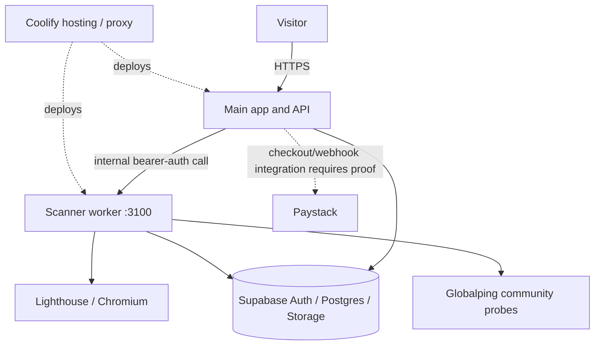

# Architecture and trust boundaries
Diagram is based on source and deployment context available 2026-10-29. Exact live routing and deployed SHA remain UNVERIFIED.

## Components
- Main app/API: root manifest uses Express and Supabase JS. [api/scan.js](https://github.com/cmwrxh/cmwrxh.github.io/blob/main/api/scan.js) validates HTTP(S), rejects embedded credentials and custom ports, applies Turnstile for anonymous scans and forwards requests to the worker.
- Worker: [worker manifest](https://github.com/cmwrxh/cmwrxh.github.io/blob/main/worker/package.json) includes Lighthouse, Chrome Launcher, Sharp, Express and Supabase JS. [worker/index.js](https://github.com/cmwrxh/cmwrxh.github.io/blob/main/worker/index.js) checks internal token, reads scan jobs, and creates signed screenshot/filmstrip URLs.
- Supabase is used for auth, database and storage. Worker references `scan_jobs`, `scan_api_keys` and `scan-screenshots`.
- Globalping probes are community-operated, not AfricaLatency-owned. Intended country list in worker source: Kenya, Nigeria, South Africa, Egypt, Ghana, Morocco, Tanzania, Uganda and Senegal.
- Coolify is the reported hosting platform; current deployment inventory and exact route mapping have not been attached. Paystack live settlement is unverified.

## Route map (source-derived, live mapping unverified)
| Route | Expected service | Status |
|---|---|---|
| `/api/scan` | Main API handler | Source verified; production mapping/SHA unverified |
| `/internal/jobs` | Scanner worker, internal token expected | Source verified; network isolation unverified |
| `/reports/<id>` | Report UI + worker-backed report data | Live auth/report behavior unverified |
| Checkout/webhook routes | Main API | Live processing/settlement unverified |
| RUM/monitoring | Proposed app/database integration | Beta/integration unverified |

## Deployment, backup and recovery
Latest inspected repository main SHA is [8aed5d0451d85965289ef23f57b6a9fba27302cd](https://github.com/cmwrxh/cmwrxh.github.io/commit/8aed5d0451d85965289ef23f57b6a9fba27302cd), dated 2026-10-28; this is not proof of deployed SHA. Backup plan, last successful export, retention and restore drill are UNVERIFIED. Before investor sharing, attach Coolify deployment export, backup evidence and isolated restore test. Do not claim PITR, daily backups, uptime or SLA without evidence.